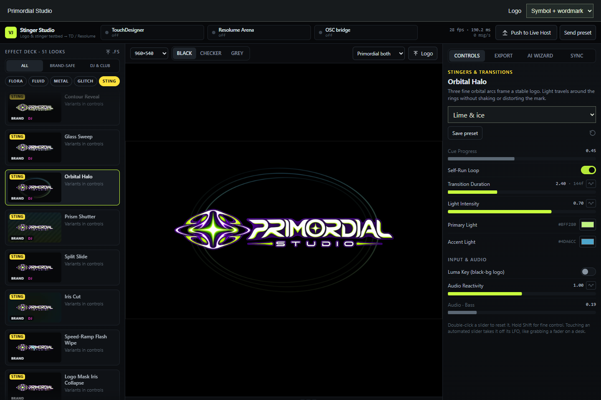

# Primordial Stinger Studio

A browser studio for EDM visuals, logo treatments, and transitions. Built from the supplied VJTB Stinger Studio, with 51 effects, variants in a dropdown, and separate Primordial symbol, wordmark, and combined logo options.

[Open the live studio](https://primordial-portfolio.netlify.app/stinger/) · [Portfolio](https://primordial-portfolio.netlify.app/)

## Open the studio

Double-click **Start-Stinger.cmd**, then open **http://127.0.0.1:5179** in Edge or Chrome. Node.js must be installed. Keep the launcher running while using the studio; Ctrl+C stops it. No npm install is required.

Alternatively, open `index.html` directly for the self-contained browser preview. The localhost launcher gives presets a consistent browser origin and is preferred for host connections.

## First session

1. Choose **STING** in the effect deck, or explore the other categories.
2. Choose a Primordial symbol, wordmark, combined logo, no logo, or the sample. Use **Logo** to load your own artwork.
3. Adjust the effect in **Controls** and use the transport to preview it.
4. Use **Save preset** for settings you want to keep. Presets live in the current browser profile; export them before changing browsers or clearing site data.
5. Choose a variant from the dropdown. Open **Export** for ISF, Wire-safe, TouchDesigner GLSL, presets, and the complete ZIP. Open **Sync** to enable and configure a host connection; connections start disabled.

Resolume and TouchDesigner compatibility is assumed at the owner's request; those live connections have not been tested in this setup. The browser preview runs independently of those hosts. The local web server serves the studio only; it is not an OSC relay or the host bridge.

## Troubleshooting

- Port busy: close an earlier launcher, or set `STINGER_PORT` to another port before running `node serve.mjs`. Changing ports creates a different browser storage origin.
- Slow rendering: select 960×540 and enable hardware acceleration in the browser.
- Host shows unavailable: use the settings and instructions in **Sync**. This does not prevent browser preview.
- The preview bundles its code and logo assets; no package installation or remote font service is needed.

## Repository contents

- `index.html`: the runnable, self-contained application bundle.
- `effects/`: 51 editable ISF shaders and their file manifest: 45 original effects and six Primordial studies.
- `VJTB-ExportPack.zip`: a fresh export from this version, including host formats and presets.
- `touchdesigner/`: the supplied Web Server DAT callbacks.
- `docs/`: interface screenshot, original architecture reference, and effect design rules.

The original architecture reference describes the upstream TypeScript project. This repository publishes the supplied standalone build and extracted shader sources; that upstream build tree is not included. Editing a shader file does not automatically change the bundled app. Import it through the studio to preview changes, then export the result.

Browser preview, logo selection, variant selection, and ZIP export were checked in Edge. Live Resolume and TouchDesigner connections remain unverified. The portfolio uses 45 original effects in a separate compositor, with the stinger layer after the video effects.
